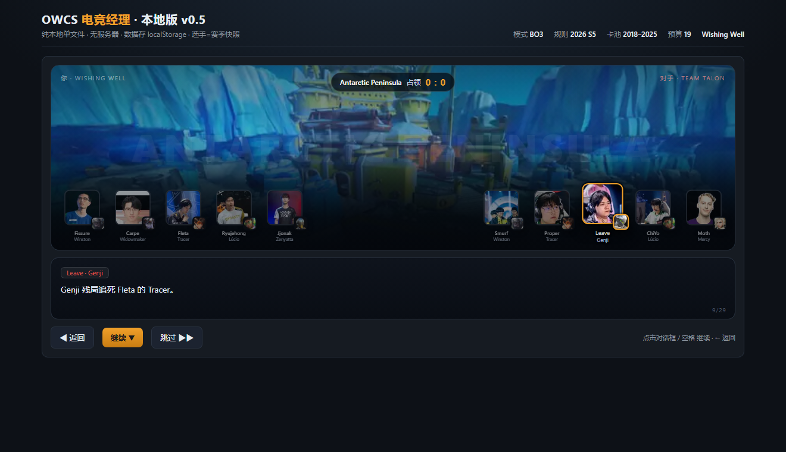
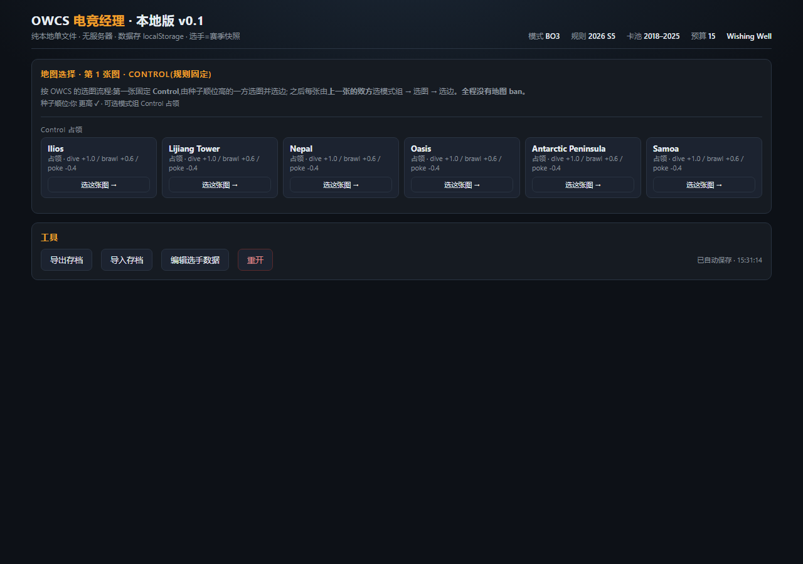
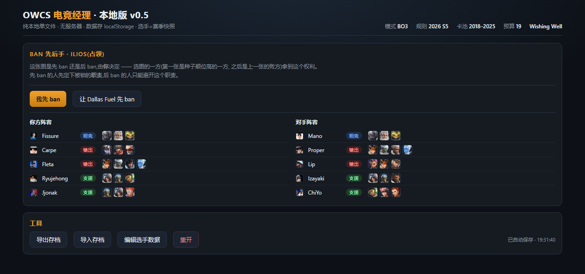
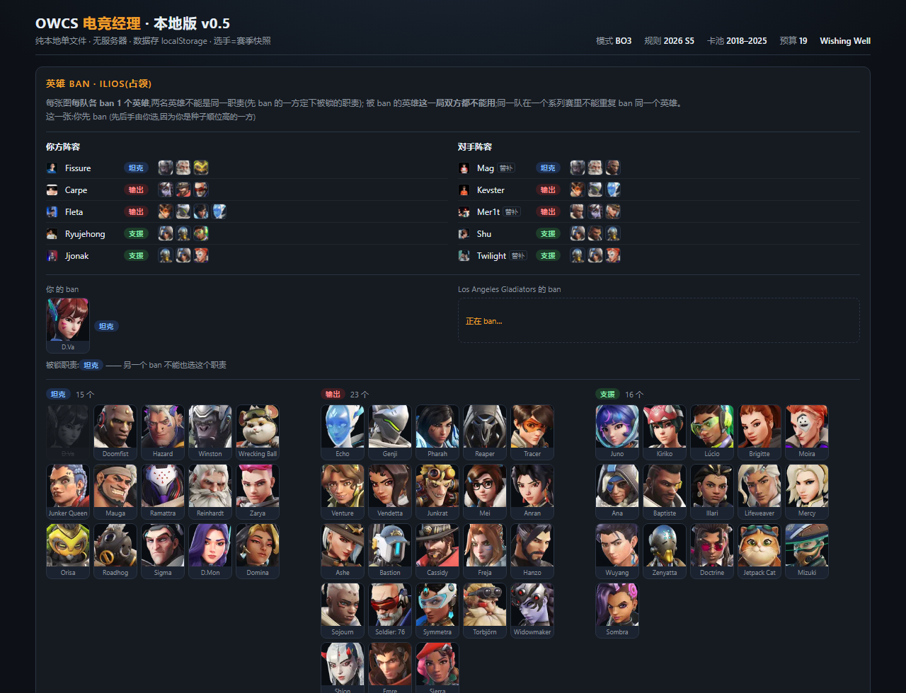

# OWCS 电竞经理 · 本地版

一个《守望先锋》电竞经理小游戏:跨时代挑选手组队、打 OWCS 赛制的 BO3、当教练选图 ban 英雄,从网吧杯一路打到世界赛。
**整个游戏是一个 HTML 文件**,零依赖、零服务器、不联网也能玩。



## 三种玩法

| 方式 | 怎么做 |
|---|---|
| **最快** | 下载 `owcs-manager.html`,双击用浏览器打开 |
| **手机** | 下载后用**浏览器**打开(⚠️ 微信里直接点 html 会被禁用 JS,见「打不开怎么办」) |
| **在线** | 仓库 Settings → Pages → Source 选 `main` / `(root)`,之后访问 `https://<你的用户名>.github.io/<仓库名>/` |

## 怎么玩

1. **建队** —— 输入战队名,选难度(轻松 / 标准 / 地狱)。
2. **选秀** —— 140 预算,按位置分三页(坦克 / 输出 / 支援)选 1 + 2 + 2。每张卡是「选手 × 赛季」的快照:2021 的 Leave 和 2023 的 Leave 是两张不同的卡,但同一选手只能选一个赛季版本。**身价按综合分指数上涨**(72 分 $6、80 分 $20、84 分 $31、88 分 $44),便宜的五人组 $36、顶级五人 $191 —— 140 永远买不到满配,必须取舍。选人的时候系统会替你**预留**后面几个位置的最低开销,不会让你把钱花到买不起剩下的人。
3. **选图(教练层)** —— **没有地图 ban**。第一张固定 **Control**,由种子顺位高的一方选图 + 选边;之后每张由**上一张的败方**选:先挑模式组(Hybrid/Flashpoint、Push、Escort),再挑图,再挑边。同一张图一场比赛内不会重复。
4. **ban 先后手** —— 选图的那一方(第一张是种子顺位高的,之后是上一张的败方)拿到决定权:**自己先 ban,还是让对方先 ban**。先 ban 的人先定下被锁的职责,所以这个选择是有代价的。
5. **英雄 ban(教练层)** —— 每张图开打前,**每队各 ban 1 个英雄**;先 ban 的一方定下被锁的**职责**,另一队不能再 ban 同职责;被 ban 的英雄这一局**双方都不能用**;同一队在一个系列赛里不能重复 ban 同一个英雄。ban 的时候**两边阵容是摊开摆着的**:每个人名、位置、只玩哪几个英雄都看得见,被本局/本系列赛 ban 掉的英雄会划掉灰显。
6. **选体系** —— Dive(突进)/ Brawl(近身)/ Poke(远程),三角克制:突进克近身、近身克远程、远程克突进。
7. **排阵容(教练层)** —— 五个人一人一个英雄,默认按招牌 + 体系自动分配;可以点着换,**同队不能撞英雄、被 ban 的不能选**,也可以点「＋其他」硬塞一个非招牌英雄(会打折)。每张图重新排。
8. **比赛演出** —— galgame 式的:真实地图截图当背景、选手站两边、说话的人亮起来,下方逐字对白,空格/回车推进、`←` 回退、`跳过` 直接看结论。

   一张图大约 20–28 句 / 十几到二十几条事件:开场讲规则和禁用、两边阵容,然后每个得分单元都有**一波一波的击杀镜头**(谁用什么英雄收掉谁、三杀、开大进场),最后是这一分/这一段的结算。比分随叙述一点点推进,**不会提前剧透**。
9. **复盘** —— 告诉你**为什么**赢/输:阵容强度差、地图契合、体系克制、起始边、被 ban 掉的核心英雄、随机波动,外加双方的 E/D。**E/D 不是另算的,是从解说里那一波波击杀累计出来的** —— 解说里谁杀了谁,数据里就算谁头上。
10. **生涯** —— 回到生涯页:看资金、打下一站赛事。**页签切到「队伍」可以安排每周事务**:派人去直播带货 / 跑商务(来钱,但吃精力)、加练(涨能力)、休息(回精力)。一个人一周只能做一件事。
11. **选手详情** —— 队伍页点「详情」(或选秀卡)看这个人的**能力雷达图**(枪法 / 意识 / 英雄池 / 心态)、招牌英雄、身价。





> 选图与 ban 的流程照的是 OWCS 官方规则书 9.4 / 9.5 节(2025 v1.2),不是 2024 年那套 FACEIT 地图 veto。

## 比赛演出

切到比赛就是一场演出:舞台上是这张地图的真实截图,你方五人站左边、对手五人站右边,谁说话谁高亮;每个得分单元有几波击杀镜头(谁用什么英雄收掉谁、三杀、开大进场),比分随叙述一点点推进 —— **不会提前剧透**,1:1 要到那一分真的打完才会变成 2:1。

E/D 不是另算的,是从这些击杀里累计出来的:解说里谁杀了谁,复盘里就算谁头上。


## 生涯:从网吧杯打到 OWCS

建队剩下的预算就是你的**启动资金**。之后是一串赛事,赢了拿奖金,输了回家凑报名费:

| 阶段 | 赛事 | 报名费 | 赛制 | 冠军额外 |
|---|---|---|---|---|
| T3 公开杯 | 城市公开赛 | **$0** | 2 场 BO3 | $30 |
| | 社区杯 | $12 | 2 场 BO3 | $40 |
| | 区域联赛 | $18 | 3 场 BO3 | $60 |
| OWCS 预选赛 | 公开预选赛 | $25 | 3 场 BO3 | $120 |
| OWCS 正赛 | Stage 1 | $30 | 3 场 BO3 | $180 |
| | Stage 2 | $35 | 3 场 BO3 | $220 |
| | Stage 3 · 年终 | $40 | 3 场 BO3 | $300 |

- 每**赢一轮**就结一次奖金(上面表里的"每轮奖金"),输一轮这次报名就结束了——报名费不退。
- 打完 2~3 轮就是冠军,拿额外奖金。**赛事可以重复报名**去刷钱,报名费照收。
- 只有前一个赛事拿到冠军,下一个才解锁。三段进度条(T3 → 预选赛 → 正赛)会跟着亮。
- **前三个杯赛的对手是 OWL 时代的老队**(Chengdu Hunters、Seoul Dynasty 这种),**OWCS 正赛换成 2026 现役强队**(Falcons、ZETA、Twisted Minds)。
- 对手强度跟赛事挂钩:城市公开赛遇到的多是拼凑队,OWCS 正赛基本就是 Falcons / Dragons / Dallas 这种。

- **赛事分级是有意义的**:每个杯赛有个"选手上限"(城市公开赛 76、社区杯 78、区域联赛 80、预选赛 86),超过上限的明星**根本不会来**——所以网吧杯里不会出现 88 分的 Leave,来的都是同档次的人。想碰 Falcons 得先打进 OWCS 正赛。

**没钱了怎么办**:去「队伍」页派人跑商务/直播(要花时间、吃精力),或者去地下赌场赌一把。

## 队伍:每周每人一件事(精力 / 商务 / 训练)

生涯页切到**「队伍 · 商务 · 训练」**页签,每个人一行:

- **直播带货** —— 来钱多($16–26),但精力 -22,下一场人基本是废的。
- **商务拍摄** —— 稳一点($9–15),精力 -12。
- **专项训练** —— 加能力(每次 +0.6,上限 +3),但精力 -16,一分钱不赚。
- **休息调整** —— 精力 +30。

规则:

- **一个人一周只能做一件事**,开打新赛事时进入下一周,安排清空、所有人恢复 8 点精力。
- **精力影响上场表现**:100 分是满状态,低于 60 开始明显掉水平,最低打九折(队伍强度里直接乘进去)。
- 所以"靠商单赚钱"和"保持竞技状态"是**真的冲突**:连轴跑去接活,下一场就打得难看。

## 地下赌场

三颗骰子,押大小/单双 1 赔 1,押豹子 8 倍:

- 大 = 11–17 点,小 = 4–10 点;
- 单/双看总点数;
- **三颗一样是豹子**:押大小单双通杀(直接输),只有押豹子才赢,8 倍。
- 可以 $10 / $25 / $50,也可以全押。

赌场记录会显示总局数与净收——赢了会记在生涯页,输光了就只能回去接商单。这是本地存档里的虚拟币,没有充值也没有提现。

## 对手是谁

对手不是随机拼出来的,是**真实战队**。现在有 23 支:OWCS 2026 的 Team Falcons、ZETA DIVISION、Crazy Raccoon、T1、Twisted Minds、Virtus.pro、Team Peps、Team Liquid、Dallas Fuel、Spacestation、NTMR、Weibo Gaming、Al Qadsiah,加上 OWL 时代的 Shanghai Dragons、London Spitfire、LA Gladiators、San Francisco Shock、NYXL、Seoul Dynasty、Philadelphia Fusion、Hangzhou Spark、Atlanta Reign、Chengdu Hunters。

每支队伍按"这五个人真实待过这支队伍"来配,卡池里有的位置直接用本人(比如 Shanghai Dragons 就是 Fate / Fleta / Lip / Izayaki / Leejaegon,Team Falcons 是 Someone / Proper / Heesang / ChiYo / Fielder)。

两只手会改写这个阵容:

1. **你把人抢走了** —— 你选中了某个战队的选手,那个位置就用一个**替代者**顶上:同位置、英雄池重合度最高、综合分接近、优先同一赛季的人。所以抢 Fleta 之后,Shanghai Dragons 会拿一个同样吃 Tracer/Genji 的输出顶上,而不是凭空变强或变弱。
2. **卡池里本来就没这个位置** —— 用水平接近这支队伍平均值的同位置选手补,不会让 Chengdu Hunters 突然冒出个 94 分的明星。

如果你把一支队的核心抢得太干净(剩下的真实成员少于 2 个),对手会**换一支还留着阵容的队**——不会出现"Seoul Dynasty 五个人全是替补"这种场面。

难度决定他们大概是哪一档的队伍:轻松多碰弱队(还会把关键属性往下压),地狱基本是最强的那几支。

## 每种地图的规则

不同模式的计分方式不一样,不是全都"先到 3 分":

| 模式 | 规则 | 比分长什么样 |
|---|---|---|
| Control(占领) | **三局两胜,先到 2 分** | 2-0 / 2-1 |
| Flashpoint(闪点) | 先到 3 分 | 3-0 / 3-2 |
| Escort(护送) | 攻防各一轮,最多 3 个检查点;同分进加时 | 3-2 / 2-1 |
| Hybrid(混合) | 同 Escort | 3-1 / 2-0 |
| Push(推车) | 双方各推一次,**比距离** | 128.4m : 96.7m |

## 英雄是怎么分的(赛前可以自己排)

每张图开打前有一个**排阵容**页面:五个人一人一个下拉位,点英雄头像就换人。

- 每人默认拿的是"招牌英雄里最贴合这套体系"的那个 —— 不想动可以直接点「开打」
- **同队不能撞英雄**(谁占了谁就变灰),**被 ban 的英雄直接不可选**
- 想让他玩招牌以外的英雄:点那行的「＋其他」,能从同位置全英雄里硬挑一个,但这种**不是招牌,队伍强度会打折**,页面上会标出来
- 每张图都重新排一次(ban 也不同),所以"这张图让他玩 X,那张图换 Y"是真的能做的
- 选完可以随时点「自动分配」回到系统推荐

老将卡按**当年的位置**算:2021 的输出选手照样能玩 Sombra(那时候她是输出),但 2026 的输出就不能选她了;同理 2019 的 Sparkle 能玩 Doomfist(那时他是输出),2022 之后 Doomfist 归坦克。这条规则写在 `ROLE_SHIFT` 里。

招牌英雄的来源:OWL 时代 34 张卡来自 Stats Lab 的真实出场时间(每个英雄打满 60 分钟以上才计入,再按"这张卡当年的位置"过滤);2025/2026 的现役选手没有公开数据,按公开阵容资料和选手习惯手工整理的,README 下面「数值是怎么来的」一节有说明。

## 存档

- 每次操作自动存进浏览器 `localStorage`,关掉再打开会接着上次。
- 底部「导出存档」可以存成 `.json` 备份,「导入存档」读回来。
- 清浏览器数据会一起清掉存档,重要进度请导出。

## 数据

| 项目 | 数量 | 说明 |
|---|---|---|
| 选手卡 | 112 张 | 2018–2026,OWL 时代 + OWCS 现役;数值按公开比赛印象给分 |
| 选手头像 | 91 张 | 72×72 webp,现场照(缺 5 人:Liquipedia 上没有可用图,退回首字母色块) |
| 英雄 | 54 个 | 含 2026 新英雄 Doctrine;Sombra 已按 2026 S5 改为支援(输出位选不到) |
| 英雄头像 | 54 张 | 88×88 webp,官方立绘 |
| 地图 | 27 张 | Control / Escort / Hybrid / Push / Flashpoint(Clash 已移除,当前赛制不打) |
| 地图背景 | 26 张 | 720×288 webp 横条,官方地图截图 |

## 数值是怎么来的(OWL 官方数据)

**34 张 OWL 时代的卡(2018–2023)的四维和招牌英雄,全部由官方 Stats Lab 的逐图数据算出**,不是手打分。

数据源是暴雪 OWL Stats Lab 的 `phs_*.zip`(每行一条统计:`选手 / 队伍 / 地图 / 英雄 / 统计项 / 数值`),2018–2023 六个赛季共 ~600MB,已经落在 `data/owl/`。

**计算口径**(`tools/owl_extract.py` → `tools/owl_ratings.py` → `tools/apply_ratings.py`):

1. 每项统计先换成 **每 10 分钟速率**(`值 × 600 / 出战秒数`);
2. 在 **(位置, 赛季)** 组内做 z-score —— 不同年份的比赛节奏差很多,不能混在一起比;
3. 四维:

   | 维度 | 用到的数据 |
   |---|---|
   | **枪法** | 击杀、终结击杀、英雄伤害、单杀 的 z 加权 |
   | **意识** | 死亡数(反向)、大招效率(使用 ÷ 获得)、助攻 |
   | **心态** | 逐图影响力的**稳定度**(1 − 变异系数),同位置百分位 |
   | **英雄池** | 当季打满 **60 分钟** 的英雄个数 → 2 个 68 / 3 个 76 / 4 个 84 / 5 个 90 |

4. 前三项再做一次**仿射校准**(中位数落到 82),这一步只是把数值塞进游戏的价格曲线,不改变选手之间的相对次序;
5. **出战不足 300 分钟**的样本(比如 Diem 2021 只有 104 分钟)会向同位置均值收缩一半,卡片上标"样本少"。

综合分仍是按位置加权:

| 位置 | 枪法 | 意识 | 英雄池 | 心态 |
|---|---|---|---|---|
| 坦克 | 30% | **35%** | 15% | 20% |
| 输出 | **45%** | 20% | 20% | 15% |
| 支援 | 20% | **35%** | 25% | 20% |

**剩下 78 张卡(2024–2026)没有公开的逐图数据**,四维是按队伍水平估算的,卡片上不显示 `▣ OWL ...` 那行 —— 有数据的卡才会标。整体做了平移,让两类卡的中位数都是 82。

想自己重算:把 `phs_*.zip` 放回 `data/owl/`,依次跑

```bash
python tools/owl_extract.py     # 抽出卡池里这些选手的逐图数据
python tools/owl_ratings.py     # 算四维
python tools/apply_ratings.py   # 写回 owcs-manager.html
```

觉得哪张卡不对,也可以直接改:

> 页面底部 **「编辑选手数据」** → 直接改 JSON → 保存,立刻生效。

加人:`tools/add_players.py` 会校验英雄名并去重,或直接照着格式加一行:

```js
P("Proper",2025,"dps",95,90,84,88,["Tracer","Sojourn","Genji"],"备注")
// 名字, 赛季, 位置(tank/dps/sup), 枪法, 意识, 英雄池, 心态, 英雄列表, 备注
```

## 素材是怎么来的(以及怎么重新生成)

成品是单文件,**素材由脚本生成并内联**,源码里不依赖任何图片路径:

```bash
# 1) 选手照片(可选,已经抓好了,重抓才需要)
python tools/fetch_players.py        # 走 Wayback 上的 Liquipedia 页面,~38 次请求

# 2) 生成并内联全部素材 → 写回 owcs-manager.html
python tools/build.py
```

- **英雄立绘**:[OverFast API](https://overfast-api.tekrop.fr/) 的官方英雄图 → 88×88 webp。
- **选手照片**:Wayback Machine 上 Liquipedia 选手页的信息框图 → 取顶部 72% 的正方形(头部/肩部)→ 72×72 webp。直接打 Liquipedia 会被 429,所以走存档。
- **地图背景**:[OverFast API](https://overfast-api.tekrop.fr/) 的官方地图截图(1200×750)→ 上下裁成 2.5:1 的横条 → 720×288 webp,构建时压暗 10%。`Watchpoint: Grímsvötn` 官方还没传图,用渐变底顶着。
- 中间产物 `assets/` 只是**构建缓存**,删掉不影响游戏;`assets/players_raw/`、`assets/maps_raw/` 里是原图,重新构建时不用再联网。

### 零外部素材模式

```bash
python tools/build.py --procedural
```

这个模式**不下载任何图片**,英雄头像改成代码绘制的徽记(按职责配色 + 首字母 + 体系图标:突进 ▲ / 近身 ■ / 远程 ◯),选手照片保持不变。整个 html 降到 ~230KB,而且不含任何暴雪美术。想公开分发时可以先用这个版本。

## 手机端

单文件、零依赖，手机浏览器直接打开就能玩（建议「添加到主屏幕」，跟 App 差不多）。

- 三个断点：**860px**（平板，卡片从 3 列降到 2 列）、**620px**（手机，全部单列、按钮变大）、**380px**（小屏，英雄图标再缩一档）
- 比赛演出在手机上从"左右对立"改成**上下两排**，10 个立绘按屏宽等比缩放（`.ch` 用 19% 宽度 + `aspect-ratio:1`），不会横向溢出
- 选秀、赛事、英雄 ban 网格全部换成单列/自适应列；ban 页的双方阵容和英雄网格会竖向堆叠
- 队伍页每人一行拆成两行：上面是名字+精力条，下面是四个行动按钮（按钮 `flex:1 1 auto`，窄屏自动换行）
- 复盘表格：字号降到 11px，列不换行，容器横向可滚
- 详情弹窗：雷达图和属性列表从左右布局改成上下堆叠，`max-height:92vh` 可滚

截图：[docs/mobile.png](docs/mobile.png)

## 打不开 / 白屏怎么办

**如果只看到「正在启动…」的说明文字,或者只看到标题和一些按钮却点不动** —— 说明页面脚本没被执行。
最常见的原因是**在微信里直接点开了 html 文件**:微信的内置文件预览器出于安全会禁用 JavaScript,
不管文件本身有没有问题,都只会显示静态 HTML。

换成真正的浏览器打开:

- **安卓**:微信里点右上角「…」→「用其他应用打开」→ 选 Chrome / Edge / 夸克 / 系统浏览器
- **iOS**:微信里没有可靠的"用浏览器打开"入口,建议先「保存到文件」,再到「文件」App 里长按 → 共享 → 用 Safari 打开;或者在电脑上打开
- **电脑**:双击就行(可直接用浏览器打开),体验也最好

另外一个办法:**微信内置浏览器对 http/https 网页是正常执行 JS 的**,只有本地文件预览被禁用。
所以如果把这个 html 挂到任意静态托管上(自己的服务器、对象存储、内网),在微信里直接点链接就能玩——
代价是网址公开即不可逆(见文末风险提示)。

v0.9.1 起做了四层兜底:

1. **静态说明卡**:`#app` 里预置了一段纯 HTML 的提示,JS 没跑起来时它会一直显示,并直接告诉你该怎么办
2. **看门狗**:主脚本若整段语法报错,会显示「这个浏览器跑不动」并打出 UA
3. **渲染兜底**:`render()` 包了 try/catch,报错会显示具体错误 + 「重置并重开」按钮
4. **旧存档兼容**:读档时遇到不认识的状态(比如旧版本的 `veto`)会回落到建队页

另外去掉了两处新语法(`??` 和 `Object.fromEntries`),老的 Android WebView / iOS Safari 也能跑。

## 已知限制

- **没有直播视角了**:v0.7 做过一版三栏转播界面,评价不好已移除,现在只有故事演出。
- **次级联赛的"选手上限"是按感觉定的**(76/78/80/86),不是官方分级;调 `EVENTS[].cap` 就能改。
- **精力/训练是粗粒度的**:一周一件事,训练涨的是总评分不是单个英雄的熟练度。
- 只有一个 BO3,没有赛季进程、转会、青训、赞助、财务。
- 战队名单是**按选手真实待过的队伍**聚合的,不是某个具体赛季的完整首发;卡池没有的人会用替补逻辑补(见上)。
- 比赛是概率模型 + 文案模板,没有真技能、地图几何、经济这些;解说是「关键镜头」,不是逐次击杀的完整回放(E/D 按 3.2 倍折算回整场)。
- 英雄 ban 影响的是"核心英雄被 ban → 这张图打打折",不建模逐个英雄之间的克制。
- 老将的卡只保留当季数值,拉进 2026 的规则里照常打,**没有"跨时代打折"**。
- 击杀台词是手写的,**54 个英雄各一套**:Pharah 是两发火箭、Widowmaker 才有一枪、Reinhardt 是抡锤、Lúcio 是推开再补掉。没覆盖到的细节(具体技能名、连招)仍然是简化描述。
- 「重开」不用浏览器弹窗,改成**点两次确认**(第一次按钮变成"再点一次确认",4 秒内再点才执行),免得弹窗被环境吞掉时看起来像点了没反应。
- 起始边只在 Escort / Hybrid 上生效(防守 +0.5),Control 等对称图无差别。

## 开发

```bash
node dev/test.js   # 数据完整性 + 全流程回归(选图/职责锁 ban/比分规则/英雄指派/BO3/存档)
node dev/soak.js   # 360 个赛季,看三档难度的胜率
```

单文件、零依赖,`dev/` 里的脚本只用了 Node 内置模块(`vm` + 一个极简 DOM stub)。回归里专门盯了这几件事:Control 的比分不超过 2、被 ban 的英雄不会出现在对阵双方、同一队没有重复英雄、每张图解说至少 18 句且每个得分单元至少 3 个带名字的选手镜头、复盘里的 E/D 确实来自事件。

当前难度胜率(自动贪心建队 + 自动选体系,每档 260 个赛季):**轻松 ~87%、标准 ~53%、地狱 ~16%**。

## 风险提示(重要)

这是个**非官方、非商业的粉丝项目**,和暴雪娱乐没有关系。

- **英雄立绘是暴雪的官方美术素材,选手照片是赛事现场摄影作品**。自己本地玩没问题,但一旦**公开分发**(上传站点、GitHub Pages、贴群),就是实打实的版权风险,DMCA 下架是常见处理。
- 选手姓名、战队名、赛事信息来自公开报道与 Liquipedia,属于事实性信息整理;但给真实选手打低分、编负面剧情,可能触及姓名权 / 名誉权。
- 标题里的 **"OWCS"**、以及英雄/战队名称,在公开分发时属于**商标性使用**。
- 想公开又不想惹麻烦:用 `tools/build.py --procedural` 去掉官方美术、换标题、选手改用化名。引擎和数据是分开的,数据整个替换掉就能变成别的项目的"电竞经理"。

## 许可

代码 MIT。英雄立绘、英雄/战队名称的相关权利归暴雪娱乐;选手照片的权利归原摄影者 / Liquipedia;选手数据与赛事名称的相关权利归各自权利人。
